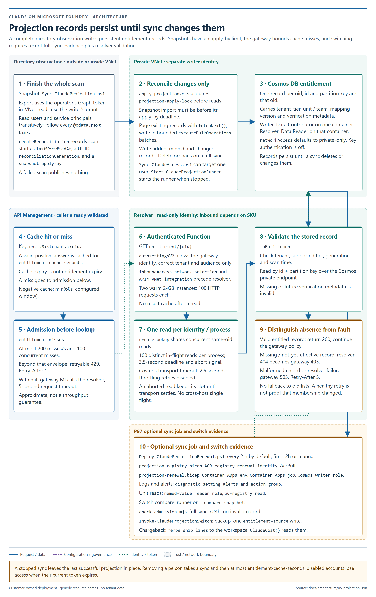
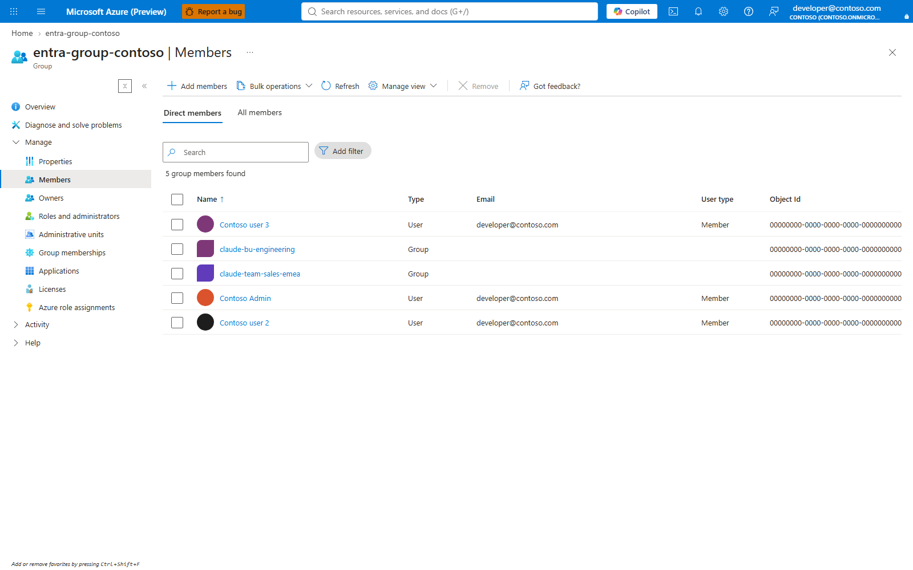
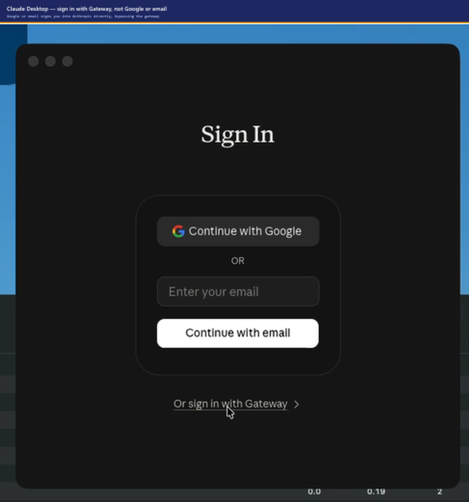
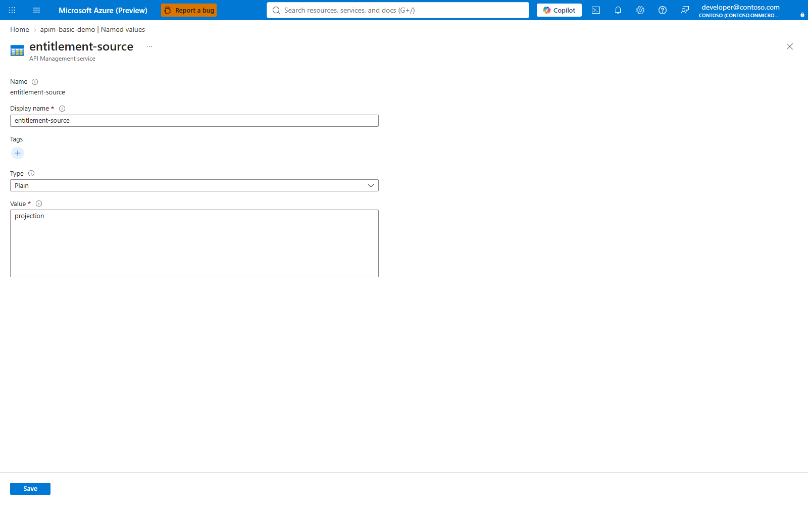

# Admin runbook: helper-script sign-in to interactive Desktop and Cosmos projection

This runbook moves an existing gateway through two independent changes:

1. Claude Desktop changes from the Azure CLI credential helper to its own interactive
   Microsoft Entra browser sign-in.
2. Gateway entitlement changes from API Management named values to the Cosmos projection,
   only after the projection matches the named-value decisions and the switch evidence passes.

The accompanying Excel workbook is
[`ADMIN-HELPER-TO-INTERACTIVE-PROJECTION-WORKBOOK.xlsx`](ADMIN-HELPER-TO-INTERACTIVE-PROJECTION-WORKBOOK.xlsx).
It contains operator inputs, roles, go/no-go checks, commands, Intune scripts, verification,
rollback and source references.

## At a glance

| Phase | What happens | Writes | Steps |
|---|---|---|---|
| [0 Inputs](#phase-0-record-the-migration-inputs) | Record subscription, gateway, groups, prefix and owners | None | — |
| [1 Preflight](#phase-1-read-only-preflight) | Azure context, current source, gateway backup, registration preview, projection preflight | Backup file only | 1-5 |
| [2 Desktop sign-in](#phase-2-change-claude-desktop-to-interactive-browser-sign-in) | Public-client app, recorded `desktopSignIn`, gateway audience, regenerated profiles | One named value | 6-9 |
| [3 Intune pilot](#phase-3-intune-pilot) | Deterministic machine policy to the pilot group only | Client registry | 10-13 |
| [4 Projection](#phase-4-deploy-and-compare-the-cosmos-projection) | Deploy, populate, compare, full sync, dry-run switch, live switch | Projection, then `entitlement-source` | 14-17 |
| [5 Verify](#phase-5-verify) | Read back the source, prove one user update, check the clients | None | 18-20 |
| [Rollback](#rollback) | Desktop and projection roll back independently | Named values | — |



Phase 4 moves the gateway onto the right-hand path in this diagram
([Architecture](ARCHITECTURE.md#projection-freshness-switch-evidence-and-private-networking),
[Secure projection](SECURE-PROJECTION.md)).

## Scope

This is an attended migration for an existing gateway. Named values remain authoritative while
the projection is deployed and compared. The Desktop sign-in migration is piloted before the
entitlement switch.

Claude Code and the VS Code extension continue to use Azure CLI Foundry authentication. The
interactive sign-in change applies to Claude Desktop only
([Developer guide](../DEVELOPER.md#letting-desktop-do-the-sign-in-itself)).

## Roles

| Role | Responsibility | Required access |
|---|---|---|
| Azure operator | Back up the gateway, update the Desktop audience, deploy and switch the projection | Resource-group deployment rights, APIM named-value read/write, resolver site configuration read and runner access |
| Entra application administrator | Create or approve the Desktop public-client registration and consent policy | Application registration rights; consent rights when tenant policy blocks user consent |
| Entra group reader | Supply the clean entitlement snapshot | Delegated Graph group membership read; full sync needs `GroupMember.Read.All` |
| Intune administrator | Pilot and assign Desktop/Claude Code managed configuration | Intune configuration, platform script or Remediations rights |
| Network administrator | Approve private resolver networking when Standard v2 or Premium v2 uses private inbound access | VNet, subnet, private DNS and join/write rights |

Azure subscription Owner is not an Entra directory role. Projection rights are listed in
[Secure projection](SECURE-PROJECTION.md#one-command-deployment).

## Phase 0: record the migration inputs

Record these values in the workbook **Inputs** sheet:

- subscription id;
- tenant id;
- resource group;
- API Management service name;
- safe projection prefix;
- APIM SKU and Azure location;
- standard and premium Entra group names;
- resolver inbound access and an existing resolver application id, when applicable;
- Desktop application display name;
- Intune pilot group;
- operator names and planned change window.

The projection prefix is 1-37 lowercase letters or digits with separated hyphens and
alphanumeric ends. `BasicV2` uses a public resolver. `StandardV2` and `PremiumV2` default to
private resolver access ([Secure projection](SECURE-PROJECTION.md#one-command-deployment)).

## Phase 1: read-only preflight

### 1. Confirm the Azure context

```powershell
az account show --query "{subscription:id,tenant:tenantId,user:user.name}" -o json
az account set --subscription '<subscription-id>'
```

The subscription and tenant must match the target gateway and the planned Desktop public-client
registration.

### 2. Read the current source and Desktop audience

```powershell
$rg = '<resource-group>'
$apim = '<apim-name>'

az apim nv show -g $rg --service-name $apim `
  --named-value-id entitlement-source --query value -o tsv

az apim nv show -g $rg --service-name $apim `
  --named-value-id external-idp-extra-audience --query value -o tsv
```

The first value must be `named-value` for this runbook. Preserve the current Desktop audience in
the change record.

### 3. Back up the gateway before either change

```powershell
$stamp = [DateTime]::UtcNow.ToString('yyyyMMdd-HHmmss')
pwsh -NoProfile -File .\scripts\Backup-ClaudeGateway.ps1 `
  -ResourceGroup $rg -ApimName $apim `
  -Path ".\backups\before-interactive-projection-$apim-$stamp.json"
```

Keep the generated backup and the existing `onboarding/claude-gateway.json` with the change
record. Secret named values are not exported by API Management
([Backup script](../scripts/Backup-ClaudeGateway.ps1)).

### 4. Preview the Desktop public-client registration

```powershell
pwsh -NoProfile -File .\scripts\New-ClaudeDesktopEntraApp.ps1 `
  -DisplayName 'Claude Desktop gateway' -WhatIf
```

The browser flow uses `http://127.0.0.1/callback`. `-Broker` additionally configures the broker
redirect URIs. The script is idempotent and does not grant tenant-wide consent
([Desktop sign-in](../DEVELOPER.md#letting-desktop-do-the-sign-in-itself)).

### 5. Run the projection preflight

```powershell
pwsh -NoProfile -File .\scripts\Deploy-ClaudeProjection.ps1 `
  -SubscriptionId '<subscription-id>' `
  -ResourceGroup '<resource-group>' `
  -ApimName '<apim-name>' `
  -NamePrefix '<projection-prefix>' `
  -Location '<location>' `
  -Sku '<BasicV2|StandardV2|PremiumV2>' `
  -ResolverInboundAccess '<public|private>' `
  -ResolverAppId '<resolver-app-id>' `
  -StandardGroup '<standard-group>' `
  -PremiumGroup '<premium-group>' `
  -PreflightOnly
```

Omit `-ResolverAppId` when the operator is allowed to create the resolver registration. Omit
`-PremiumGroup` only when the deployment deliberately uses the documented default. Do not pass an
empty argument.

The command makes no Azure writes and exits nonzero on a failed check. It checks tools,
subscription, gateway identity, Graph reads, tier groups, resolver registration, providers,
roles and derived names. Cosmos regional capacity remains a note because it cannot be reserved by
preflight ([Secure projection](SECURE-PROJECTION.md#one-command-deployment)).



The tier groups the preflight names are the groups the projection is populated from
([Onboarding](ONBOARDING.md)).

The workbook is **NO-GO** while any mandatory preflight row is blank or failed.

## Phase 2: change Claude Desktop to interactive browser sign-in

### 6. Create or discover the public-client application

```powershell
pwsh -NoProfile -File .\scripts\New-ClaudeDesktopEntraApp.ps1 `
  -DisplayName 'Claude Desktop gateway'
```

Record the returned `clientId`, `tenantId`, `issuer` and redirect URI. An Entra administrator
reviews tenant consent policy. If the tenant blocks user consent, the pilot may receive
`AADSTS65001` or **Need admin approval** until an authorized administrator grants consent
([Developer guide](../DEVELOPER.md#letting-desktop-do-the-sign-in-itself)).

### 7. Record the approved Desktop configuration

Back up the handover file first:

```powershell
Copy-Item .\onboarding\claude-gateway.json `
  ".\onboarding\claude-gateway.before-interactive-$stamp.json"
```

Set `desktopSignIn` in `onboarding/claude-gateway.json`:

```json
{
  "desktopSignIn": {
    "kind": "external-idp",
    "flow": "browser",
    "bearerTokenType": "id_token",
    "issuer": "https://login.microsoftonline.com/<tenant-id>/v2.0",
    "clientId": "<desktop-public-client-id>"
  }
}
```

This is the documented `id_token` browser shape. Access-token mode additionally needs gateway API
scopes and an audience and is outside this runbook
([Developer guide](../DEVELOPER.md#letting-desktop-do-the-sign-in-itself)).

Validate the record before writing the gateway audience:

```powershell
. .\scripts\ClaudeDesktopSignIn.ps1
$record = Get-Content .\onboarding\claude-gateway.json -Raw | ConvertFrom-Json
$desktop = Get-ClaudeDesktopSignIn -Config $record
$desktop | Format-List
```

### 8. Allow the Desktop application audience at the gateway

The documented manual change path is a gateway backup followed by one named-value write
([Update and change](UPDATE-AND-CHANGE.md#5-change-claude-desktop-sign-in)):

```powershell
. .\scripts\ApimNamedValue.ps1
Set-ApimNamedValue -ResourceGroup $rg -ApimName $apim `
  -Id external-idp-extra-audience `
  -Value '<desktop-public-client-id>'
```

Read the value back:

```powershell
az apim nv show -g $rg --service-name $apim `
  --named-value-id external-idp-extra-audience --query value -o tsv
```

The result must exactly match the public-client application id.

### 9. Regenerate the managed policy payloads

```powershell
pwsh -NoProfile -File .\scripts\New-ClaudeCodePolicy.ps1 `
  -ConfigPath .\onboarding\claude-gateway.json `
  -Tier standard `
  -OutputPath .\policy-claude-code-standard

pwsh -NoProfile -File .\scripts\New-ClaudeCodePolicy.ps1 `
  -ConfigPath .\onboarding\claude-gateway.json `
  -Tier premium `
  -OutputPath .\policy-claude-code-premium
```

The Desktop outputs are `claude-desktop.managed-settings.json`,
`claude-desktop.reg` and `claude-desktop.mobileconfig`. The Claude Code outputs include
`claude-code.managed-settings.json`, `claude-code.reg`,
`claude-code.intune-omauri.csv` and `claude-code.mobileconfig`
([MDM guide](MDM.md#2-generate-the-profiles)).

The default `-DesktopKeySpelling original` supports every Desktop release since 1.25927.0.
`-DesktopKeySpelling current` requires Desktop 2.7032.0 or later across the fleet
([MDM guide](MDM.md#2-generate-the-profiles)).

## Phase 3: Intune pilot

### 10. Select the deterministic Windows delivery mechanism

Use the generated OMA-URI row only when the tenant has a matching custom ADMX or Policy CSP route
for `ClaudeCode`. A fresh Intune tenant does not automatically understand the third-party
`ClaudeCode` CSP path. The deterministic options are a platform script, Remediation or Win32 app
script ([MDM guide](MDM.md#31-claude-code-policy)).

For a platform script or Remediation:

| Intune setting | Value |
|---|---|
| Run this script using the logged on credentials | No |
| Enforce script signature check | Organization policy; No unless signed by a trusted publisher |
| Run script in 64-bit PowerShell host | Yes |

### 11. Claude Code platform/remediation script

Embed the exact generated `claude-code.managed-settings.json` document:

```powershell
$ErrorActionPreference = 'Stop'
$settings = @'
<paste claude-code.managed-settings.json as one JSON document>
'@
$key = 'HKLM:\SOFTWARE\Policies\ClaudeCode'
New-Item -Path $key -Force | Out-Null
New-ItemProperty -Path $key -Name Settings -PropertyType String `
  -Value $settings -Force | Out-Null
```

Detection script:

```powershell
$expected = '<sha256 of the exact Settings string>'
$value = (Get-ItemProperty `
  -Path 'HKLM:\SOFTWARE\Policies\ClaudeCode' `
  -Name Settings -ErrorAction SilentlyContinue).Settings
if (-not $value) { exit 1 }
$sha = [System.Security.Cryptography.SHA256]::Create()
try {
  $bytes = $sha.ComputeHash([System.Text.Encoding]::UTF8.GetBytes($value))
}
finally {
  $sha.Dispose()
}
$actual = -join ($bytes | ForEach-Object { $_.ToString('x2') })
if ($actual -eq $expected) { exit 0 }
exit 1
```

These scripts use Windows PowerShell 5.1-compatible APIs exactly as documented in
[MDM](MDM.md#31-claude-code-policy).

### 12. Claude Desktop policy

Desktop values belong directly under `HKLM\SOFTWARE\Policies\Claude`; subkeys are ignored.
Use the generated `claude-desktop.reg` with a Remediation or Win32 package:

```powershell
reg.exe import .\claude-desktop.reg
if ($LASTEXITCODE -ne 0) { throw "Claude Desktop policy import failed: $LASTEXITCODE" }
```

The `.reg` file must be packaged with the script. Fully quit and reopen Claude Desktop after the
policy lands. See [MDM](MDM.md#32-claude-desktop-policy).

### 13. Assign only to the pilot group

In Intune admin center:

1. **Devices > Scripts and remediations > Platform scripts**, or
   **Devices > Manage devices > Scripts and remediations > Create script package**.
2. Assign the generated tier payload to the agreed pilot user or device group.
3. Monitor **Device status** and **User status**.
4. Confirm the managed Desktop keys, restart Desktop and complete the browser sign-in.
5. Confirm a request reaches the gateway before broad assignment.



The pilot user selects **Or sign in with Gateway**, not Google or email
([Developer guide](../DEVELOPER.md#letting-desktop-do-the-sign-in-itself)).

User-group assignment follows entitled users across devices. Device-group assignment applies the
same tier profile to every user on that device
([MDM](MDM.md#34-assignment-monitoring-update-and-rollback)).

## Phase 4: deploy and compare the Cosmos projection

### 14. Deploy, populate and compare without switching

Run the same command that passed preflight, without `-PreflightOnly`:

```powershell
pwsh -NoProfile -File .\scripts\Deploy-ClaudeProjection.ps1 `
  -SubscriptionId '<subscription-id>' `
  -ResourceGroup '<resource-group>' `
  -ApimName '<apim-name>' `
  -NamePrefix '<projection-prefix>' `
  -Location '<location>' `
  -Sku '<BasicV2|StandardV2|PremiumV2>' `
  -ResolverInboundAccess '<public|private>' `
  -ResolverAppId '<resolver-app-id>' `
  -StandardGroup '<standard-group>' `
  -PremiumGroup '<premium-group>'
```

The deployer:

- deploys private Cosmos and the resolver path;
- writes the resolver URL, audience and projection prefix;
- exports the named-value decisions;
- populates the projection from Entra;
- compares the projection with the named-value decisions;
- leaves `entitlement-source` unchanged.

The successful terminal message is:

```text
Clean comparison complete; named values remain authoritative. To switch now, rerun with -FlipAfterCleanCompare.
```

Do not proceed without this result
([Secure projection](SECURE-PROJECTION.md#one-command-deployment)).

### 15. Publish a fresh full-sync evidence record

```powershell
pwsh -NoProfile -File .\scripts\Sync-ClaudeAccess.ps1 `
  -ResourceGroup '<resource-group>' `
  -ApimName '<apim-name>'
```

The switch needs a successful full sync within 24 hours for the same Cosmos account and tenant.
The optional scheduled job is not required for the switch
([Secure projection](SECURE-PROJECTION.md#prerequisites)).

### 16. Dry-run the switch

`-FlipAfterCleanCompare` deploys nothing. `-WhatIf` runs the resolver checks, named-value drift
check, runner compare and switch evidence, then stops before the backup and write:

```powershell
pwsh -NoProfile -File .\scripts\Deploy-ClaudeProjection.ps1 `
  -SubscriptionId '<subscription-id>' `
  -ResourceGroup '<resource-group>' `
  -ApimName '<apim-name>' `
  -NamePrefix '<projection-prefix>' `
  -StandardGroup '<standard-group>' `
  -PremiumGroup '<premium-group>' `
  -FlipAfterCleanCompare -WhatIf
```

This is the final no-write gate. A refusal leaves `entitlement-source` unchanged and writes no
switch backup ([Secure projection](SECURE-PROJECTION.md#switch-to-the-projection-p95)).

### 17. Switch entitlement

Remove only `-WhatIf`:

```powershell
pwsh -NoProfile -File .\scripts\Deploy-ClaudeProjection.ps1 `
  -SubscriptionId '<subscription-id>' `
  -ResourceGroup '<resource-group>' `
  -ApimName '<apim-name>' `
  -NamePrefix '<projection-prefix>' `
  -StandardGroup '<standard-group>' `
  -PremiumGroup '<premium-group>' `
  -FlipAfterCleanCompare
```

The switch writes a projection-switch backup and performs one live configuration write:
`entitlement-source=projection`.

## Phase 5: verify

### 18. Read back the source

```powershell
az apim nv show -g '<resource-group>' --service-name '<apim-name>' `
  --named-value-id entitlement-source --query value -o tsv
```

Expected value: `projection`.



The portal path is **API Management > APIs > Named values > `entitlement-source`**
([Secure projection](SECURE-PROJECTION.md#switch-to-the-projection-p95)).

### 19. Prove one user update

After an approved Entra group change:

```powershell
pwsh -NoProfile -File .\scripts\Sync-ClaudeAccess.ps1 `
  -ResourceGroup '<resource-group>' `
  -ApimName '<apim-name>' `
  -User '<upn-or-object-id>'
```

Graph replication can be delayed. A just-created group or membership may need the command to be
resumed after the directory read succeeds.

### 20. Complete the application checks

- Pilot Desktop signs in through the browser and sends the configured Desktop application
  audience.
- The gateway accepts the pilot request.
- Claude Code and VS Code continue to use Azure CLI Foundry authentication.
- `entitlement-source` is `projection`.
- A changed developer is published by `Sync-ClaudeAccess.ps1 -User`.
- A subsequent full sync completes without an unexpected deletion refusal.
- Intune reports the pilot assignment as successful.

## Rollback

### Desktop sign-in rollback

1. Restore the saved `onboarding/claude-gateway.json`.
2. Restore `external-idp-extra-audience` from the gateway backup, or set it empty for the
   helper-script path.
3. Regenerate the tier profiles.
4. Deploy the regenerated helper-script Desktop policy to the pilot group.
5. Fully quit and reopen Desktop.

### Projection rollback

Named values may have become stale while projection served. Refresh and compare them before
changing the source:

```powershell
pwsh -NoProfile -File .\scripts\Sync-ClaudeAccess.ps1 `
  -ResourceGroup '<resource-group>' -ApimName '<apim-name>' `
  -Store named-value

pwsh -NoProfile -File .\scripts\Compare-ClaudeEntitlement.ps1 `
  -ResourceGroup '<resource-group>' -ApimName '<apim-name>' `
  -FailOnDrift

. .\scripts\ApimNamedValue.ps1
Set-ApimNamedValue -ResourceGroup '<resource-group>' -ApimName '<apim-name>' `
  -Id entitlement-source -Value named-value
```

Rollback to named values is safe only while the population fits their capacity: approximately
93 developers in business-unit membership and 110 per tier list
([Secure projection](SECURE-PROJECTION.md#quickstart)).

## Source references

- [Desktop sign-in choice ADR](adr/0027-claude-desktop-sign-in-choice.md)
- [Desktop client configuration](../DEVELOPER.md#letting-desktop-do-the-sign-in-itself)
- [Update and change: Desktop sign-in](UPDATE-AND-CHANGE.md#5-change-claude-desktop-sign-in)
- [Secure Cosmos projection](SECURE-PROJECTION.md)
- [Projection workbook](PROJECTION-WORKBOOK.md)
- [Intune, Jamf and Group Policy](MDM.md)
- [`New-ClaudeDesktopEntraApp.ps1`](../scripts/New-ClaudeDesktopEntraApp.ps1)
- [`New-ClaudeCodePolicy.ps1`](../scripts/New-ClaudeCodePolicy.ps1)
- [`Deploy-ClaudeProjection.ps1`](../scripts/Deploy-ClaudeProjection.ps1)
- [`Sync-ClaudeAccess.ps1`](../scripts/Sync-ClaudeAccess.ps1)
- [`Compare-ClaudeEntitlement.ps1`](../scripts/Compare-ClaudeEntitlement.ps1)
