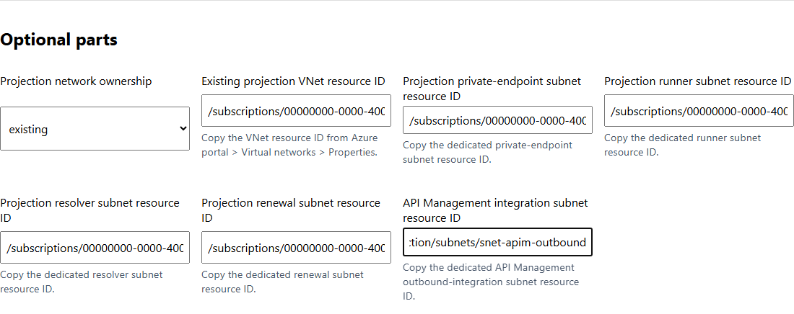
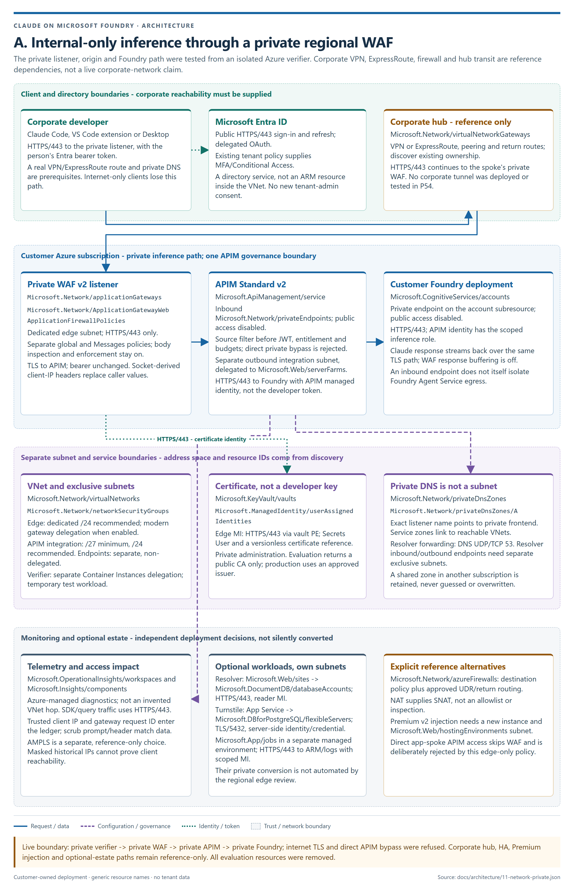
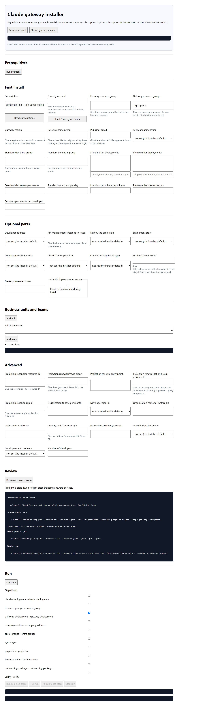
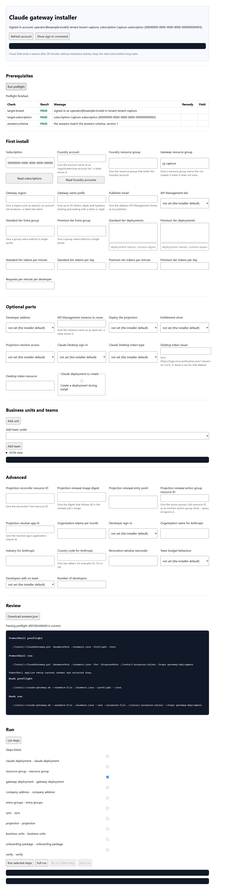
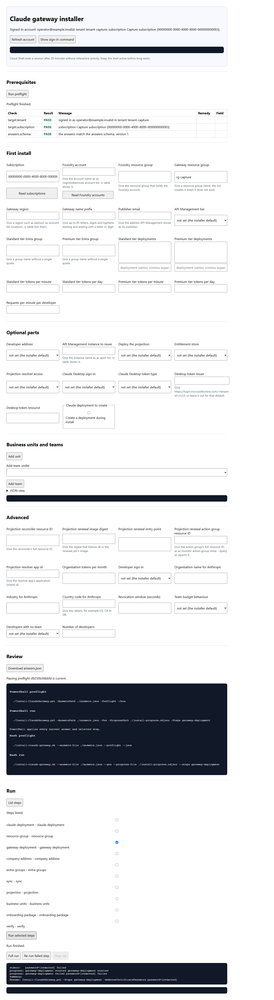

# Production deployment with nine plans and 47 access-profile groups

This runbook deploys the private Cosmos entitlement projection, publishes the
nine-plan and 47-profile access catalog, performs the first full sync, and
enables scheduled synchronization. It uses the supported P116 commands and the
example catalog in
[`config/access-catalog.example.json`](../config/access-catalog.example.json).

The workflow has four boundaries:

1. Entra groups are created or adopted before catalog publication.
2. `Install-ClaudeGateway.ps1` deploys the Azure resources in one unattended
   command from an answers file.
3. `Set-ClaudeAccessCatalog.ps1` validates and publishes the tenant-bound
   catalog. It does not create Entra groups or change their membership.
4. A Privileged Role Administrator or Global Administrator grants the renewal
   identity Microsoft Graph application permission in one command.

The catalog supports up to 16 plans and 64 enabled profiles. The shipped
example contains nine plans and 47 Entra profile groups
([ADR-0062](adr/0062-cosmos-access-profile-catalog.md#decision)).

This sequence is for a new gateway or a pilot with no existing production
traffic. An active named-value gateway moves through
[`Update-ClaudeGateway.ps1`](UPDATE-AND-CHANGE.md#move-a-named-value-gateway-with-the-update)
so its current entitlement remains authoritative until comparison and switch
evidence pass. On a new gateway, profile membership is added after the catalog
publication and first full sync below. This avoids a period in which the
projection contains only the installer compatibility groups.



## Roles

| Role | Work |
|---|---|
| Azure operator | Runs preflight, deployment, catalog publication, attended sync and verification. |
| Entra Groups Administrator or permitted group creator | Creates or adopts the 47 profile groups and manages their membership. |
| Privileged Role Administrator or Global Administrator | Grants `GroupMember.Read.All` to the scheduled job's managed identity. Azure subscription Owner is not sufficient. |
| Network team | Supplies the customer VNet and five dedicated subnet resource IDs when `ProjectionNetworkMode` is `existing`. |

The detailed Azure, Graph and runner rights are listed in
[Projection workbook: Roles](PROJECTION-WORKBOOK.md#roles) and
[Secure projection: Rights used by the checks](SECURE-PROJECTION.md#rights-used-by-the-checks).

## 1. Prepare the repository and sign in

```powershell
git fetch origin
git switch PRODUCTION
git pull --ff-only origin PRODUCTION

az login
az account set --subscription <subscription-id>
az account show -o table
```

PowerShell 7, Azure CLI, Bicep, Node.js, npm and `tar` are required. The
installer preflight checks these dependencies and the selected Azure estate
before any write
([Setup: Answers file, preflight and selected steps](SETUP.md#answers-file-preflight-and-selected-steps)).

## 2. Create or adopt the 47 profile groups

The example contains deliberately fake tenant and group GUIDs. Publishing it
unchanged fails tenant binding or group resolution. The following attended
PowerShell block:

- reads the signed-in tenant;
- creates or adopts one exact display name per profile;
- refuses ambiguous exact names;
- replaces every fake `groupObjectId`;
- writes the environment-specific catalog under `onboarding/`.

The default display-name convention is `LTM-Claude-<profile-id>`. Change the
`$displayName` line before the first run if the customer requires another
convention. The profile ID remains the stable catalog key.

```powershell
$ErrorActionPreference = 'Stop'
$templatePath = '.\config\access-catalog.example.json'
$catalogPath = '.\onboarding\access-catalog.production.json'
$guid = '^[0-9a-fA-F]{8}(?:-[0-9a-fA-F]{4}){3}-[0-9a-fA-F]{12}$'

function Invoke-AzJson {
    param([Parameter(Mandatory)][string[]]$Arguments)
    $text = az @Arguments 2>&1 | Out-String
    if ($LASTEXITCODE -ne 0) {
        throw "Azure CLI failed: az $($Arguments -join ' ')`n$($text.Trim())"
    }
    if (-not $text.Trim()) { return $null }
    return $text | ConvertFrom-Json
}

$account = Invoke-AzJson @('account', 'show', '-o', 'json')
if ([string]$account.tenantId -notmatch $guid) {
    throw 'The signed-in Azure account did not return a tenant GUID.'
}

$catalog = Get-Content -Raw -LiteralPath $templatePath | ConvertFrom-Json
if (@($catalog.plans).Count -ne 9 -or @($catalog.profiles).Count -ne 47) {
    throw 'The selected template is not the shipped nine-plan, 47-profile catalog.'
}
$catalog.tenantId = ([string]$account.tenantId).ToLowerInvariant()

foreach ($profile in @($catalog.profiles)) {
    $displayName = "LTM-Claude-$($profile.id)"
    $listed = @(Invoke-AzJson @('ad', 'group', 'list', '--display-name', $displayName, '-o', 'json'))
    $exact = @($listed | Where-Object {
        [string]::Equals([string]$_.displayName, $displayName, [StringComparison]::Ordinal)
    })
    if ($exact.Count -gt 1) {
        throw "More than one Entra group has the exact display name '$displayName'."
    }
    if ($exact.Count -eq 0) {
        $mailNickname = 'ltmclaude' + ([string]$profile.id -replace '[^a-z0-9]', '')
        $group = Invoke-AzJson @(
            'ad', 'group', 'create',
            '--display-name', $displayName,
            '--mail-nickname', $mailNickname,
            '-o', 'json'
        )
        Write-Host "Created $displayName"
    }
    else {
        $group = $exact[0]
        Write-Host "Adopted $displayName"
    }
    if ([string]$group.id -notmatch $guid) {
        throw "Entra did not return a valid object ID for '$displayName'."
    }
    $profile.groupObjectId = ([string]$group.id).ToLowerInvariant()
}

New-Item -ItemType Directory -Force -Path (Split-Path $catalogPath) | Out-Null
$catalog | ConvertTo-Json -Depth 12 | Set-Content -LiteralPath $catalogPath -Encoding utf8
Write-Host "Prepared $catalogPath with $(@($catalog.profiles).Count) profile groups."
```

This block does not add users. Membership remains customer-managed through
Entra ID, identity governance or another approved provisioning system.
Environment-specific catalog files under `onboarding/` are ignored by Git.

### From a customer group sheet
 customer sheet that lists each group's display name, level, credit, model set, capabilities (`Co`, `Cw`, `Ch`, `De`) and M365 flag converts to this catalog with`
`.\scripts\ConvertTo-ClaudeAccessCatalog.ps1 -InputPath <sheet.json> -OutputPath .\onboarding\access-catalog.production.json`. The sheet's profiles (level, model set and credit) become one plan each, the tiers (Standard to the standard compatibility tier, Advanced and Power to premium); each row becomes one profile. Empty object ids are read from Microsoft Graph by exact display name through REST, because such names contain `$ ( ) ,`. Priorities follow highest monthly credit, then more model families, then more capabilities, then M365, so a person in several groups gets one whole profile. Per-profile token figures in the sheet are not enforced per plan. `tests/Test-CustomerAccessSheet.ps1` checks a 47-row example.

## 3. Prepare the production answers file

The answers file follows
[`schemas/claude-gateway.answers.schema.json`](../schemas/claude-gateway.answers.schema.json).
The example below selects Standard v2, the Cosmos projection, a private
resolver, the scheduled job and a customer-provided VNet.

```json
{
  "SubscriptionId": "<subscription-id>",
  "FoundryAccount": "<foundry-account>",
  "FoundryResourceGroup": "<foundry-resource-group>",
  "ResourceGroup": "<gateway-resource-group>",
  "Location": "<azure-region>",
  "NamePrefix": "<globally-unique-prefix>",
  "PublisherEmail": "<operations-email>",
  "Sku": "StandardV2",
  "StandardGroup": "<compatibility-standard-group>",
  "PremiumGroup": "<compatibility-premium-group>",
  "EntitlementStore": "projection",
  "DeployProjection": true,
  "ResolverInboundAccess": "private",
  "DeploySyncJob": true,
  "ProjectionSyncInterval": "manual",
  "DeveloperCount": 500,
  "ProjectionNetworkMode": "existing",
  "ProjectionVnetId": "/subscriptions/<subscription-id>/resourceGroups/<network-rg>/providers/Microsoft.Network/virtualNetworks/<vnet>",
  "ProjectionEndpointsSubnetId": "/subscriptions/<subscription-id>/resourceGroups/<network-rg>/providers/Microsoft.Network/virtualNetworks/<vnet>/subnets/<private-endpoints-subnet>",
  "ProjectionRunnerSubnetId": "/subscriptions/<subscription-id>/resourceGroups/<network-rg>/providers/Microsoft.Network/virtualNetworks/<vnet>/subnets/<runner-subnet>",
  "ProjectionResolverSubnetId": "/subscriptions/<subscription-id>/resourceGroups/<network-rg>/providers/Microsoft.Network/virtualNetworks/<vnet>/subnets/<resolver-subnet>",
  "ProjectionRenewalSubnetId": "/subscriptions/<subscription-id>/resourceGroups/<network-rg>/providers/Microsoft.Network/virtualNetworks/<vnet>/subnets/<renewal-subnet>",
  "ProjectionApimSubnetId": "/subscriptions/<subscription-id>/resourceGroups/<network-rg>/providers/Microsoft.Network/virtualNetworks/<vnet>/subnets/<apim-outbound-subnet>"
}
```

Save the file outside source control, for example
`onboarding/answers.production.json`.

`StandardGroup` and `PremiumGroup` are the existing compatibility and
named-value rollback groups. They are not substitutes for the 47 profile
groups. A customer that requires named-value rollback with the current user
population keeps those aggregate groups aligned with the profiles'
`compatibilityTier`.

For a projection-managed VNet, set `"ProjectionNetworkMode": "managed"` and
omit `ProjectionVnetId` plus the five subnet IDs. The installer creates the
VNet, subnets, private endpoints and private DNS links.

## 4. Customer VNet and private endpoint contract

The customer VNet must be in the selected subscription and region. Each subnet
has one role.

| Input | Required subnet state |
|---|---|
| `ProjectionEndpointsSubnetId` | Dedicated private-endpoint subnet with no service delegation. |
| `ProjectionRunnerSubnetId` | Dedicated subnet delegated to `Microsoft.ContainerInstance/containerGroups`. |
| `ProjectionResolverSubnetId` | Dedicated subnet delegated to `Microsoft.App/environments`; minimum `/27`. |
| `ProjectionRenewalSubnetId` | Separate subnet delegated to `Microsoft.App/environments`; minimum `/27`. |
| `ProjectionApimSubnetId` | Dedicated subnet delegated to `Microsoft.Web/serverFarms`; minimum `/27`, `/24` recommended. |

The customer VNet and subnets are validated but are not rewritten by P116.
The projection creates and links its own private DNS zones. A VNet already
linked to a different zone with the same private namespace is refused; reuse
of centrally managed private DNS zones is not supported in P116
([Secure projection: Prerequisites](SECURE-PROJECTION.md#prerequisites),
[ADR-0062](adr/0062-cosmos-access-profile-catalog.md#decision)).



## 5. Run read-only preflight

```powershell
.\Install-ClaudeGateway.ps1 `
  -AnswersPath .\onboarding\answers.production.json `
  -Preflight
```

Resolve every `FAIL` before deployment. Group-creation rights, customer VNet
shape, existing private DNS links, APIM name availability, Foundry deployments
and operator rights are checked before resource creation.

The local installer UI provides the same answers and preflight:

```powershell
node .\tools\installer-ui\server.mjs
```





## 6. Deploy the resources with one command

The production resource deployment command is:

```powershell
.\Install-ClaudeGateway.ps1 `
  -AnswersPath .\onboarding\answers.production.json `
  -Yes `
  -ProgressPath .\onboarding\install-progress.ndjson
```

The installer checkpoint makes the same command resumable. A failed step leaves
the previous completed steps recorded; rerunning the command verifies them and
continues. `-Restart` starts a new checkpoint and does not delete previously
created Azure resources.

The run deploys or configures the gateway, private projection, resolver,
runner, Cosmos account, private endpoints, APIM outbound VNet integration and
the manual sync job selected in the answers file. The sync job remains manual
until its Graph permission and first run are proven.



## 7. Preview and publish the catalog

Read the deployed gateway coordinates from the onboarding record:

```powershell
$gateway = Get-Content .\onboarding\claude-gateway.json -Raw | ConvertFrom-Json
```

Preview performs local validation and Azure discovery but does not start the
runner or change Cosmos. A refused catalog names the entry and rule, for
example `Problem: profile 'standard-l1-code' modelFamilies values must be one of
haiku, sonnet, opus, fable, mythos`. An enabled profile must allow at least one
model family:

```powershell
.\scripts\Set-ClaudeAccessCatalog.ps1 `
  -ResourceGroup $gateway.resourceGroup `
  -ApimName $gateway.apimName `
  -Path .\onboarding\access-catalog.production.json `
  -WhatIf
```

Publish backs up an existing catalog, writes the replacement with ETag
protection, reads it back and verifies the canonical hash:

```powershell
.\scripts\Set-ClaudeAccessCatalog.ps1 `
  -ResourceGroup $gateway.resourceGroup `
  -ApimName $gateway.apimName `
  -Path .\onboarding\access-catalog.production.json
```

Expected output includes `plans=9`, `profiles=47` and one `sha256:` catalog
version. `Set-ClaudeAccessCatalog.ps1` does not create Entra groups and does
not change membership.

### Token limits per plan

Each tier - one profile of the customer sheet, with its credit and model set -
gets monthly token limits per model family from its credit, so a USD 50 tier
and a USD 100 tier get different limits
([ADR-0069](adr/0069-token-limits-per-access-plan.md)). Preview, then write:

```powershell
.\scripts\Set-ClaudePlanTokenQuotas.ps1 -ResourceGroup $gateway.resourceGroup -ApimName $gateway.apimName `
  -CatalogPath .\onboarding\access-catalog.production.json `
  -FoundryAccount <foundry-account> -FoundryResourceGroup <foundry-resource-group> 
  -SheetPath .\onboarding\customer-sheet.json -CacheReadShare 0.5 -WhatIf
.\scripts\Set-ClaudePlanTokenQuotas.ps1 -ResourceGroup $gateway.resourceGroup -ApimName $gateway.apimName `
  -CatalogPath .\onboarding\access-catalog.production.json `
  -FoundryAccount <foundry-account> -FoundryResourceGroup <foundry-resource-group>
```

The credit is split equally across the tier's model families and converted at
the list price of Haiku 5.5, Sonnet 5.5, Opus 5.5 and Fable 5.1 (`-PriceModels`
changes them; Haiku 5.5 uses its over-100,000-token rate unless `-Haiku55PromptTier standard`). A sheet profile's `tokensPerMonth` replaces the derived figure.
Cache reads are estimated at `-CacheReadShare` (default 0.5) of
input tokens and output at `-OutputShare` (default 0.2) of tokens. The figures
approximate the dollar value; they are not a dollar cap. A person on a plan
with limits is refused for that family when the month's tokens are used, and
`x-model-family-quota-remaining` shows what is left. Run it again after
changing the catalog, the deployments or the price book.
## 8. Run the first attended full sync

```powershell
.\scripts\Sync-ClaudeAccess.ps1 `
  -ResourceGroup $gateway.resourceGroup `
  -ApimName $gateway.apimName
```

The attended command obtains a delegated Graph token locally. The token is not
sent to the private runner. The sync resolves all 47 profile groups, chooses
one whole highest-priority profile for each member, keeps business-unit
assignment independent, and writes only changed records.

Resolve these failures before enabling the schedule:

- a catalog group no longer exists;
- one identity belongs to two enabled profiles with the same highest priority;
- the catalog tenant does not match the gateway tenant;
- the removal ceiling stops an unexpectedly large deletion;
- a business-unit group or catalog profile cannot be read.

## 9. Grant scheduled synchronization with one command

The installer prints the renewal job identity principal ID and the exact grant
command. A Privileged Role Administrator or Global Administrator runs:

```powershell
.\scripts\Grant-ClaudeProjectionRenewalGraphAccess.ps1 -PrincipalId <job-managed-identity-principal-id>
```

The command is idempotent. It grants only Microsoft Graph application
permission `GroupMember.Read.All`. Managed-identity token caches can take up
to about 24 hours to reflect a new grant
(`scripts/Grant-ClaudeProjectionRenewalGraphAccess.ps1`).

## 10. Prove one job run before scheduling

Find and start the tagged job:

```powershell
$prefix = az apim nv show `
  -g $gateway.resourceGroup `
  --service-name $gateway.apimName `
  --named-value-id entitlement-projection-prefix `
  --query value -o tsv

$job = az resource list `
  -g $gateway.resourceGroup `
  --resource-type Microsoft.App/jobs `
  --tag "claude-projection-prefix=$prefix" `
  --query "[0].name" -o tsv

az containerapp job start -g $gateway.resourceGroup -n $job
```

In Azure portal, open **Container App Jobs > the renewal job > Execution
history**. A successful execution emits `projection-renewal-succeeded`.
`Authorization_RequestDenied` at stage `graph` means the permission is absent
or the managed-identity token has not refreshed.

Keep the job manual until one execution succeeds. Then set the interval:

```powershell
.\scripts\Set-ClaudeProjectionSyncSchedule.ps1 `
  -ResourceGroup $gateway.resourceGroup `
  -ApimName $gateway.apimName `
  -Interval 2h
```

Supported values are `5m`, `15m`, `30m`, `1h`, `2h`, `3h`, `4h`, `6h`, `8h`, `12h` and
`manual`.

## 11. Verify one profile movement

1. Add a pilot identity to one low-risk profile group.
2. Run targeted sync.
3. Verify a permitted model returns `200` and a family outside the profile
   returns `403`.
4. Move the identity to another profile group.
5. Run targeted sync again and repeat the request checks.

```powershell
.\scripts\Sync-ClaudeAccess.ps1 `
  -ResourceGroup $gateway.resourceGroup `
  -ApimName $gateway.apimName `
  -User <pilot-upn-or-object-id>
```

The highest-priority whole profile wins. Capabilities, model families and
connectors are not unioned across overlapping memberships. Equal highest
priority is refused before writes.

## 12. Dollar budgets

Each plan's `nominalCredit` is metadata. It records the customer's commercial
plan amount but does not create an enforced user budget.

Existing explicit P108 USD budgets remain the enforcement mechanism. Configure
organization, business-unit or user budgets with the supported budget scripts,
then run the USD reconciler. A stale or mismatched reconciled budget state
returns `503 usd_budget_state_stale`; an exceeded explicit budget returns the
documented `403` refusal
([Budgets](BUDGETS.md), [ADR-0060](adr/0060-usd-reconciler-attribution-and-pricing.md)).

## 13. Operational checks and rollback

| Check | Expected state |
|---|---|
| Catalog preview | `plans=9`, `profiles=47`, stable `sha256:` version. |
| First attended sync | No missing group, ambiguity or removal-ceiling refusal. |
| Manual job run | `projection-renewal-succeeded`. |
| Gateway record | Schema 3 with `plan`, `profile`, `capabilities`, `modelFamilies`, `connectors`, `catalogVersion` and `profileHash`. |
| Model request | Allowed family succeeds; disallowed family returns `403`. |
| Budget request | Existing explicit P108 budget behavior is unchanged. |

Catalog rollback republishes the previous backed-up catalog through
`Set-ClaudeAccessCatalog.ps1`, then runs a full sync.

Projection rollback returns the gateway to named-value entitlement only after
the Standard/Premium lists are refreshed and compared. Use the rollback command
printed by the projection switch or follow
[Projection workbook: Rollback](PROJECTION-WORKBOOK.md#rollback-to-named-values).

## References

- [P116 implementation and live proof](status/P116.md)
- [ADR-0062: Cosmos access-profile catalog](adr/0062-cosmos-access-profile-catalog.md)
- [Secure projection](SECURE-PROJECTION.md)
- [Projection operator workbook](PROJECTION-WORKBOOK.md)
- [Installer UI](INSTALLER-UI.md)
- [Desktop profile policy](MDM.md#2-generate-the-profiles)
